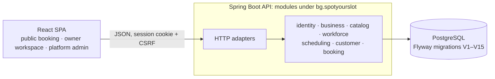

# SpotYourSlot

SpotYourSlot is a multi-tenant appointment-booking platform for small appointment-based businesses (hair and beauty
studios, massage and makeup practitioners and similar). Each Business gets a public booking page and a private
workspace to manage Services, team, working hours, Customers and an appointment calendar. It is a
Spring Boot and React application whose focus is conflict-safe scheduling; it is **not deployed** and not
production-ready (see [Limitations](#current-limitations)). The user interface is in Bulgarian; code and technical
documentation are in English.

## What works today

**Platform administration.** A platform administrator creates Businesses, invites owners and moves a Business through
`DRAFT → ACTIVE ⇄ SUSPENDED`.

**Business owner workspace.**
- Services (duration, price, activity), StaffMembers, Service assignments and recurring weekly working hours.
- Schedule changes: closures, time off, working-day overrides and additional working periods.
- Customer records with search, and a per-Customer appointment history.
- A calendar (day, week and agenda views) of online and manually created Appointments in the Business timezone.
- Manual Appointment creation (one to five Services, one StaffMember), rescheduling and reassignment, cancellation and a
  private internal note, each with explicit conflict and uncertain-outcome handling.

**Public booking.** An unauthenticated page at `/{businessSlug}` shows the Business profile and lets a guest book one to
five Services as one visit with a chosen or automatically assigned StaffMember, without an account.

## Architecture and stack

A modular monolith: one Spring Boot API, one React single-page application and one PostgreSQL database.



| Layer | Technology |
|---|---|
| Backend | Java 25, Spring Boot 4.1 (Web, Security, Data JPA, Validation), Spring Modulith, Flyway |
| Database | PostgreSQL 18 (Docker Compose for local development) |
| Frontend | React 19, TypeScript 6, Vite 8, Vitest, Testing Library |
| Testing | JUnit, Testcontainers (real PostgreSQL), Playwright (Chromium) |
| Build and CI | Maven wrapper, npm, GitHub Actions (backend, frontend, browser E2E) |

More detail: [architecture](docs/architecture.md), [data model](docs/data-model.md), [security](docs/security.md).

## Selected engineering decisions

Each decision is recorded with its alternatives in an [ADR](docs/decisions/README.md).

- **The database prevents double booking.** A PostgreSQL exclusion constraint over the StaffMember and the half-open
  time range of confirmed Appointments makes overlap impossible regardless of application bugs or races; the
  application turns the violation into a safe, typed conflict.
- **Ordered locking and bounded retry.** Booking and the owner's create, reschedule and reassign run in one
  `REPEATABLE READ` transaction per attempt, taking row locks in a documented order. Ordered locking reduces deadlock
  risk but does not prove its absence: serialization failures and deadlocks are retried as a whole new transaction, at
  most three attempts, and a deadlock between two overlapping writers on the exclusion index remains a documented,
  retried risk. A losing request creates nothing.
- **Optimistic versions and honest outcomes.** Owner mutations carry an expected version and update through one
  conditional statement. When the outcome of a request is unknown (a lost response), the interface says so and verifies
  instead of repeating the mutation.
- **Idempotent guest booking.** An attempt identifier and a versioned HMAC request fingerprint identify a repeated
  request, so it is answered as a replay or rejected as a mismatch. Whether a transaction committed is classified
  separately from Spring's completion report: a proven rollback and an uncertain outcome are different results.
- **Timezone-aware availability.** Working hours are local to the Business timezone and appointments are stored as UTC
  instants; the engine handles daylight-saving gaps and repeated hours. Guests are offered starts on a 15-minute grid
  with two hours' notice within 30 Business-local dates; the owner's Business-side policy has no notice or horizon but
  never offers a past start. Availability reserves nothing, so creation and every change of start time or StaffMember
  re-validate it inside the mutation's own transaction (cancellation and note edits do not need it).
- **Tenant isolation in depth.** For authenticated Business operations the Business comes from the server-side session,
  never the request body or path; public pages resolve it from the slug and expose only an allowlist. Every tenant table
  carries `business_id` in its keys, and another Business's data looks missing. Platform administration alone grants no
  access to a Business's private data.
- **Module boundaries that are tested.** Modules expose small published contracts, keep persistence internal, and the
  boundaries are verified by Spring Modulith in the test suite.
- **Privacy by construction.** Tokens and sessions are stored only as hashes, passwords use Argon2id, and the browser
  keeps no authentication token or private value in storage or URLs.

## Quick start

Requirements: Java 25, Node.js `>=24.15.0 <25` (a 24 LTS release at or above 24.15.0) with npm 11, and Docker with Compose.

**Terminal 1, from the repository root:** database and backend.

```bash
cp .env.example .env                 # then change the local-only password in .env
docker compose up -d postgres
cd backend
export POSTGRES_USER=spotyourslot POSTGRES_PASSWORD='the-value-from-your-.env'
./mvnw spring-boot:run               # health: http://localhost:8080/actuator/health
```

**Terminal 2, starting in the repository root:** frontend.

```bash
cd frontend
npm ci && npm run dev                # http://localhost:5173
```

Creating the first platform administrator, the configuration reference, browser-test operation, cleanup and
troubleshooting are in the [development guide](docs/development.md).

## Testing

Run each command from the repository root (the parentheses keep the root as the working directory):

```bash
(cd backend && ./mvnw --batch-mode verify)                      # unit, slice and Testcontainers PostgreSQL tests (Docker needed)
(cd frontend && npm ci && npm run lint && npm run test && npm run build)
./scripts/run-e2e.sh                                            # Playwright against a disposable stack (Docker; ports 55432, 18080, 15173)
```

Persistence, constraint, migration and concurrency behaviour is tested against real PostgreSQL, never an in-memory
substitute. The browser suite drives the real backend, and its journeys are labelled by what produced the evidence
(real, proxy or scripted). GitHub Actions (`.github/workflows/ci.yml`) runs the backend, frontend and E2E jobs on every
push; its status is advisory and is reported separately from local results. Strategy and conventions:
[testing strategy](docs/testing-strategy.md).

## Current limitations

- **Not deployed.** No hosting, domain, monitoring or backup configuration exists; `spotyourslot.bg` is only an example
  origin and has not been registered or cleared.
- **No notifications.** No email or SMS (development uses an in-memory mailbox), no reminders, no Customer accounts, and
  no Customer self-service cancellation or rescheduling.
- **Owner-only access.** Only the Business owner uses the private workspace; Manager and Staff roles are not built.
- **Fixed booking rules.** A 15-minute grid, two-hour notice and 30-day horizon, with zero buffers and no breaks, are
  fixed in code rather than configurable.
- **Single-instance limiters.** The authentication and public-booking abuse limiters are bounded and process-local; a
  multi-instance deployment would need a shared or edge limiter.
- **No drag-and-drop** rescheduling; the form is the supported flow.
- **Not measured.** No load, performance or scalability testing has been done, and there are no security scans in CI.
- **Browsers and accessibility.** End-to-end tests run in Chromium only; there has been no complete screen-reader or
  keyboard-only audit, and real 200% zoom and Firefox/Safari were not checked.
- **Licensing.** No license file is present yet.

## Documentation

[Documentation index](docs/README.md): [development guide](docs/development.md) · [API routes](docs/api.md) ·
[architecture](docs/architecture.md) · [data model](docs/data-model.md) · [security](docs/security.md) ·
[testing strategy](docs/testing-strategy.md) · [UI guidelines](docs/ui-design-guidelines.md) ·
[product specification](docs/product-spec.md) · [roadmap](docs/product-roadmap.md) · [ADRs](docs/decisions/README.md) ·
[task records](docs/tasks/). `AGENTS.md` and `CLAUDE.md` hold the working agreements used while developing this
repository with an AI coding assistant.
