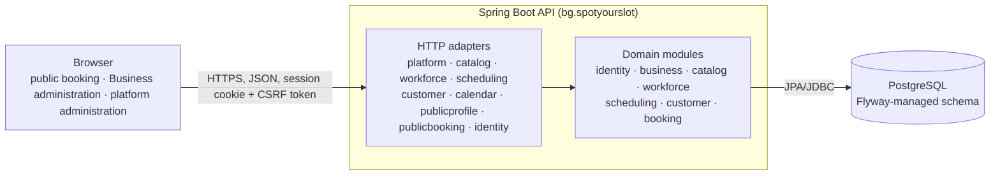

# SpotYourSlot architecture

This document describes the system as it is implemented. Reasoning behind individual decisions is in the
[ADRs](decisions/README.md); the history of how each capability was built is in the [task records](tasks/). Items that
are designed but not built are collected in [Planned and not implemented](#planned-and-not-implemented).

## Architectural style

SpotYourSlot is a monorepo and a deployable **modular monolith**: one Spring Boot REST API, one React single-page
application, and one shared PostgreSQL database. One generic booking engine serves every `BusinessType`; the type is
descriptive and has no behavioural branching ([ADR-0001](decisions/ADR-0001-use-a-modular-monolith.md)).

Spring Modulith verifies the module boundaries in the test suite. Email delivery, a transactional outbox and audit
events are designed but not built (see below); nothing in the diagram is planned-only.

## Backend modules

All packages live below `bg.spotyourslot`. A module exposes a small published contract in its root package and keeps
entities, repositories and persistence records internal. Modules reference each other by stable identifiers and
published interfaces, never by another module's tables or repositories, and there are no dependency cycles.

| Module | Responsibility |
|---|---|
| `identity` | users, credentials, sessions, invitations, password reset, Memberships, roles, the authenticated Business context |
| `platform` | `PLATFORM_ADMIN` operations and the Business lifecycle (`DRAFT → ACTIVE ⇄ SUSPENDED`) |
| `business` | Business profile, slug, timezone, lifecycle and the per-Business schedule revision guard |
| `catalog` | Business-owned Services: price, duration, activity, versioned administration |
| `workforce` | StaffMembers, Service assignments, recurring weekly working schedules |
| `scheduling` | timezone-aware availability, schedule exceptions, deterministic StaffMember assignment |
| `customer` | Business-scoped Customer records, conservative contact matching, owner administration |
| `booking` | the Appointment domain, conflict-safe creation, rescheduling, reassignment, cancellation, internal note, calendar and history reads |
| `publicprofile` | the unauthenticated, allowlisted public Business profile |
| `publicbooking` | HTTP adapter of guest booking and its abuse limiter wiring |
| `calendar` | HTTP adapter of the owner's calendar, Appointment administration and Customer history |
| `shared` | small primitives, including the contact-text, phone and email canonicalization policy |

Controllers call application use cases; authorization and transactions are not controller concerns. `publicbooking`
and `calendar` are thin adapters over the published `booking` contracts, and nothing depends on them. `booking`
depends on `business`, `catalog`, `workforce`, `scheduling`, `customer` and a few narrow `identity` types; `scheduling`
never depends on `booking`, it consumes busy time through its own `BusyIntervalSource` seam that `booking` implements.
The module-by-module lock and transaction rules are summarised below and decided in the ADRs.

## Multi-tenancy and authorization

Every tenant-owned table has a non-null `business_id`, and tenant-scoped unique keys and foreign keys include it, so
the database rejects cross-Business references (defence in depth). For authenticated Business operations the
Business comes from the server-side session's Membership, not from a request field; platform administration addresses
Businesses explicitly in its routes, and public context comes from the `{businessSlug}` path.
Row-level security is deferred: pooled-connection context adds complexity and would not replace the application
checks ([ADR-0003](decisions/ADR-0003-use-business-scoped-memberships-for-multi-tenancy.md)). Private Business APIs
require an active `BUSINESS_OWNER` Membership; `MANAGER`, `STAFF` and `PLATFORM_ADMIN` alone are denied. A resource of
another Business is indistinguishable from a missing one. Details are in [security.md](security.md).

## Time and availability

Appointments persist `[start_at, occupied_until)` as UTC `timestamptz`. Weekly schedules and exceptions use local
weekday and clock values interpreted in the Business IANA timezone (default `Europe/Sofia`), and the availability
engine handles daylight-saving gaps and repeated hours ([ADR-0013](decisions/ADR-0013-define-availability-interval-precedence-grid-and-dst-semantics.md)).
Availability intersects working intervals and overrides, subtracts time off and blocking Appointments, and applies
qualification, notice and horizon rules with an injected clock. The current MVP fixes a 15-minute grid, a two-hour
notice and a 30 Business-local-date horizon for guests, with zero buffers and no breaks. The owner's Business-side
policy ([ADR-0029](decisions/ADR-0029-calculate-business-availability-with-a-separate-policy-and-serialize-appointment-mutations-with-ordered-locks-optimistic-versions-and-bounded-retry.md))
uses no notice and no horizon, a start never in the past, and ignores only the Appointment being moved. Its duration
is the sum of the *current* Service durations when an Appointment is created, but the Appointment's *stored* duration
when it is rescheduled, so a later Service change does not alter an existing visit. A displayed availability result
reserves nothing: creation and every change of start time or StaffMember re-validate availability inside their own
transaction (cancellation and note edits depend on no availability).

`scheduling.AvailabilityQuery` assembles the pure engine's inputs from narrow published contracts (Business schedule
context, Service identity and duration, StaffMembers with their weekly periods) in a bounded number of statements,
independent of team size. Errors use RFC 7807 problem bodies with a stable `code`.

## Conflict-safe booking

PostgreSQL is the final arbiter. A GiST exclusion constraint on `staff_member_id WITH =` and
`tstzrange(start_at, occupied_until, '[)') WITH &&`, restricted to `CONFIRMED` rows, makes two overlapping confirmed
Appointments of one StaffMember impossible, allows adjacency, and ignores cancelled rows
([ADR-0022](decisions/ADR-0022-model-appointments-with-snapshots-two-statuses-and-a-database-overlap-exclusion.md)).
The application adds ordered locking and retry around it so that losing requests get a clean, typed conflict:

- **One transaction per attempt** at `REPEATABLE READ`, started by the operation itself; a caller transaction is
  rejected. A retry (at most three attempts) is always a completely new transaction, and a transaction that threw is
  never continued ([ADR-0023](decisions/ADR-0023-book-appointments-in-one-repeatable-read-transaction-with-ordered-locks-and-bounded-whole-transaction-retry.md)).
- **A documented lock order** for the booking paths (guest booking, and the owner's create and reschedule): Business lifecycle row, Membership row, StaffMember row, Business schedule
  revision row, Service row, then Customer, Appointment and aggregate rows
  ([ADR-0025](decisions/ADR-0025-coordinate-schedule-changes-with-booking-through-a-business-level-schedule-revision-guard.md)).
  The revision row is advanced by every weekly-schedule and schedule-exception mutation and locked shared by the booking
  paths, so a booking that read older schedule data fails and retries instead of committing against stale availability.
  Other operations take only the prefix they need (cancellation and note edit lock just the Business lifecycle, owner
  Membership and Appointment rows). Ordered locking reduces deadlock risk; it
  is not a deadlock-freedom proof: a deadlock between two overlapping writers on the exclusion index remains a documented,
  retried risk.
- **Optimistic versions.** Owner mutations (reschedule, reassign, cancel, internal note) carry `expectedVersion` and
  write through one conditional `UPDATE`; a stale version is reported as a conflict instead of overwriting
  ([ADR-0007](decisions/ADR-0007-use-optimistic-concurrency-for-business-mutations.md), ADR-0028).
- **Idempotent guest booking.** An attempt identifier plus a versioned HMAC request fingerprint identify a repeated request
  (a replay, or a mismatch if the content differs). Separately, the outcome classification distinguishes a proven rollback
  from an uncertain commit, and an uncertain outcome is reported as uncertain rather than as a failure
  ([ADR-0024](decisions/ADR-0024-make-booking-attempts-idempotent-with-a-versioned-hmac-request-fingerprint-and-distinguish-uncertain-outcomes.md)).
- **Multi-Service visits** (one to five Services, one StaffMember) are one atomic Appointment with immutable per-Service
  lines and a whole-visit overlap guarantee ([ADR-0027](decisions/ADR-0027-book-several-services-as-one-atomic-visit-with-service-lines-a-versioned-set-fingerprint-and-an-explicit-review-consistency-check.md)).
- The owner's mutations run in a separate, non-transactional runner that classifies the outcome from Spring's
  completion report and verifies with one read outside the transaction; cancellation and note edit use a single
  `READ COMMITTED` transaction with no retry (ADR-0029).

## Transactions and locking by slice

The same pattern repeats across the owner-administered slices, so the rules are stated once here (details in the ADRs
listed in [Backend modules](#backend-modules) and in [security.md](security.md)):

- **Reads** run in read-only transactions with non-locking Business and Membership authorization checks. Reads that
  must be consistent across several statements (assignment listing, a StaffMember's weekly schedule, the schedule
  exception list, availability, the calendar and history reads) use one `REPEATABLE READ` snapshot with a bounded,
  size-independent statement count.
- **Mutations** run in one transaction that takes shared locks in the fixed order Business lifecycle row, exact user
  Membership row, then (where scoped) the StaffMember row, and finally the aggregate through a conditional
  `UPDATE ... WHERE version = :expected`. The version predicate is never replaced by a pessimistic aggregate lock, and
  an accepted mutation that writes increments the version exactly once, including an identical complete replacement
  of a Service assignment set or weekly schedule. The exceptions are requests that change nothing: an Appointment
  reschedule that changes neither start nor StaffMember, and an internal-note edit equal to the stored note, issue no
  `UPDATE` and do not advance the version.
  A `SUSPENDED` Business remains readable and rejects mutations (Customer updates excepted).
- **Services and assignments:** Catalog locks only the Service rows being added, `FOR SHARE` in deterministic UUID
  order, before Workforce reconciles the relationships; the version guard and the reconciliation share one transaction.
  A StaffMember's profile, lifecycle and assignment replacement share one aggregate version; the weekly working
  schedule has its own independent version, and a database exclusion constraint rejects overlapping periods per
  weekday while allowing adjacency.
- **Schedule exceptions** are versioned aggregates with their periods. PostgreSQL exclusion constraints, not a
  pre-check, decide overlap. Replace and delete are conditional on Business, identifier and expected version, and an
  empty conditional result is treated as a concurrent change rather than distinguishing missing from stale.
- **Platform Business lifecycle:** activation is one read-write transaction whose identity query locks one qualifying
  active owner Membership (`ORDER BY id LIMIT 1 FOR SHARE`), so a concurrent deactivation waits for the transition.
- **Availability** (`AvailabilityQuery`) writes nothing and takes no locks. Called inside an existing transaction it
  joins it and fails before any read unless that transaction is `REPEATABLE READ` or `SERIALIZABLE`.
- **Public profile:** one read-only `REPEATABLE READ` transaction with at most two statements, independent of the
  number of Services; a malformed or reserved slug issues none.

## Customers

A Customer record is Business-owned data, not a login. Guest booking finds or creates the record through the published
`CustomerIdentification` contract inside the booking transaction, with conservative matching on canonical phone and
email ([ADR-0020](decisions/ADR-0020-match-customers-conservatively-and-publish-narrow-customer-contracts.md)); the same
person has separate records in different Businesses. A persistence race raises a sanitized typed conflict that marks the
caller's transaction for rollback. An Appointment does not copy the contact data; the owner sees it through the
Customer reference. A `SUSPENDED` Business keeps its existing Customers correctable but cannot create new ones.

## Frontend

The React SPA (TypeScript, Vite) serves the public booking journey at `/{businessSlug}` and the authenticated
Business-owner and platform-administrator interfaces, all in Bulgarian. Routing is application-owned and hash-based
for the authenticated shells, without a routing dependency. The authenticated navigation is shared: global destinations (`Бизнеси`, `Профил`) and, while a Business is selected, `График`, `Услуги`, `Екип`, `Работно време` and `Клиенти`. Business-scoped feature code lives under
`frontend/src/business/` (`calendar`, `appointments`, `customers`, `services`, `staff`, `schedule`) and the platform and
public code under `platform/` and `public/`. Every Business API call goes through one request helper that announces the
single `ACTIVE_BUSINESS_REQUIRED` signal, on which the shell refreshes the session and returns to Business selection.
Server versions are kept in memory and sent back as `expectedVersion`; they are not displayed. No authentication token or
private value is stored in browser storage or the URL by design. Forms use a shared unsaved-changes guard, and owner operations
use single-flight requests with explicit handling of uncertain outcomes (an uncertain mutation is not repeated automatically).
The UI rules are in [ui-design-guidelines.md](ui-design-guidelines.md).

## Authentication and sessions

Administrators and owners use server-managed sessions (opaque cookie, `HttpOnly`, `SameSite=Lax`, `Secure` in
production) with CSRF protection; invitation, reset and session tokens are stored only as hashes, and passwords use
Argon2id ([ADR-0005](decisions/ADR-0005-use-server-managed-cookie-authentication.md),
[ADR-0006](decisions/ADR-0006-protect-security-tokens-with-hash-only-persistence-and-database-backed-lifecycle-guarantees.md)).
Authentication and public-booking abuse limiters are bounded and process-local (ADR-0008, ADR-0026), so a multi-instance
deployment needs a shared or edge limiter. See [security.md](security.md).

## Planned and not implemented

Designed but not built: transactional outbox and email delivery, reminders, Customer self-service cancellation and
rescheduling, audit events, Manager and Staff access (needs a Membership-to-StaffMember link), drag-and-drop
rescheduling, configurable booking window, notice and buffers, breaks, and production hosting. The production proposals
(Cloudflare Pages, a paid Render service and PostgreSQL, Resend) are unconfigured, and the example domain
`spotyourslot.bg` is not registered and has not been legally cleared. The planned `notification` and `audit` modules do
not exist in the code.

## Version and evolution policy

Versions are verified against official primary documentation, direct dependencies, tools and Docker image tags are
pinned, lockfiles are committed, and pre-release or experimental dependencies need separate approval. Flyway owns
schema evolution. Scaling would begin with measurement, indexes, stateless replicas and pool tuning; speculative
industry abstractions, Redis, Kafka, microservices and Kubernetes are excluded.

### Verified bootstrap versions

Verified on 2026-08-13 from official documentation and package metadata. The manifests are authoritative
(`backend/pom.xml`, `frontend/package.json`, `compose.yaml`, `.github/workflows/ci.yml`).

| Technology | Selected version | Compatibility basis |
|---|---:|---|
| Java | Temurin 25 LTS | required project LTS; Spring Boot 4.1 supports Java 17–26 |
| Spring Boot | 4.1.0 | stable GA; supports Java 25 and Maven 3.6.3+ |
| Maven / Wrapper | 3.9.16 / 3.3.4 | the wrapper pins the distribution |
| Node.js / npm | 24 LTS (CI 24.19.0) / 11.17.0 | `engines`: Node `>=24.15.0 <25`, npm `>=11 <12` |
| React / React DOM | 19.2.8 | stable release resolved at bootstrap |
| TypeScript | 6.0.3 | compatible with `typescript-eslint` 8.67.0 |
| Vite / React plugin | 8.2.1 / 6.0.5 | stable; support Node 24 |
| Vitest / jsdom | 4.1.10 / 30.0.1 | stable; support Node 24 |
| PostgreSQL | 18.4 (`postgres:18.4-bookworm`) | current stable major |
| Testcontainers | managed by Spring Boot 4.1 | real-PostgreSQL integration tests |
| Spring Modulith | 2.1.0 | module verification in tests |
| Playwright | 1.63.0 | pinned Chromium for browser E2E |

Direct npm dependencies are exact-pinned and the lockfile fixes the graph; Docker images use full tags. GitHub Actions
are pinned to reviewed major lines (`checkout@v6`, `setup-java@v5`, `setup-node@v6`).
